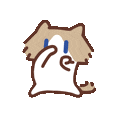

  <!-- Taruh banner 3D keren di sini -->

  
  

    
    
  

---

### 🧑‍💻 Get to Know Me

<table border="0">
  <tr>
    <td width="60%" valign="top">
      Hey! I'm <b>Kevin</b>, an <b>Informatics Engineering Student</b> (3rd semester) at Universitas Pancasila. I bridge the gap between creative <b>UI/UX Design</b> and robust <b>Web Development</b>. 
        
      Whether I’m prototyping in Figma, writing backend logic in Laravel, or exploring Artificial Intelligence, I’m always striving to build things that are fast, intuitive, and visually stunning. Let's create something impactfull! 🚀
        
      <ul>
        <li>🎓 Striving for excellence at <b>Universitas Pancasila</b></li>
        <li>💼 Previously interned as a <b>Business Analyst</b> at PT Blox Home Indonesia</li>
        <li>🌱 Currently leveling up my skills in <b>Laravel, PHP, & UI/UX prototyping</b></li>
        <li>💬 Ask me about: web tech, anime, or my latest gym routine!</li>
      </ul>
    </td>
    <td width="40%" valign="middle" align="center">
      <!-- Ilustrasi tambahan atau stats interaktif -->
      
    </td>
  </tr>
</table>

---

### 🛠️ Tech Stack & Tools

  <!-- Languages & Frameworks -->
  
  
  
  
  
   
  <!-- Design & Tools -->
  
  
  

---

### 🚀 Highlighted Projects

  
<b>📂 Web Development</b>

  <ul>
    <li>🏫 <b>SMP Mentari Portal</b> - School web application built with Laravel, Breeze, SQLite, and Tailwind CSS.</li>
    <li>🧠 <b>RecoverAI</b> - Mental health platform powered by intelligence, built for a web development competition.</li>
    <li>💈 <b>NOIR Barbershop</b> - Responsive landing page utilizing HTML5, CSS3, and Vanilla JS.</li>
  </ul>

  
<b>🎨 UI/UX Projects</b>

  <ul>
    <li>☕ <b>Sruput Coffee</b> - Mobile UI/UX prototype designed in Figma for the Techno IT Competition.</li>
  </ul>

---

### 📊 My GitHub Stats

  
  

  

